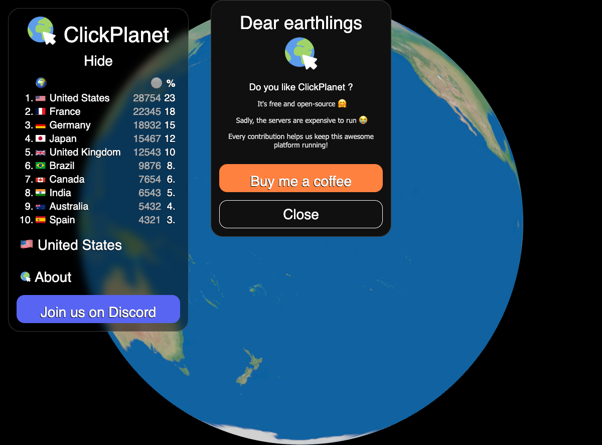
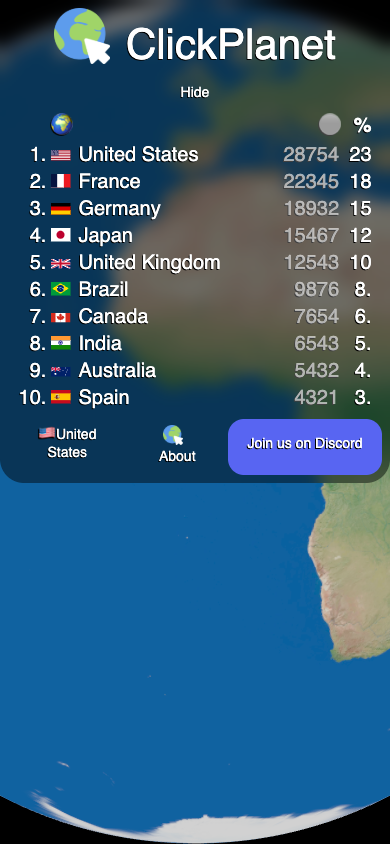

# Plan : refaire le globe de citywars sur tuile

*Étude du 25/10/2026. tuile est étudié au tag `v0.14.0` (commit e973e2c0), lu en lecture seule. Le checkout local de tuile est en retard : il est encore à v0.12.0, donc les analyses passent par `git show v0.14.0:…`.*

**Périmètre décidé** : citywars reste simple. Seule la technologie du globe change : three.js est remplacé par tuile, à fonctions identiques. On n'ajoute rien de nouveau, et citywars n'a aucune dépendance ni intégration avec defendmybase. Les idées d'extension sont rangées dans l'annexe « hors périmètre ».

---

## 0. Résumé

- **Constat principal.** Le webapp Rust (`clickplanet-webapp`, Dioxus 0.6) n'affiche aujourd'hui qu'une **sphère texturée avec OrbitControls**. Les tuiles cliquables ne sont pas dessinées, il n'y a ni clic, ni websocket, ni chargement des propriétaires. Le leaderboard est codé en dur. Ces fonctions n'existent que dans le front TypeScript d'origine de ClickPlanet, que citywars était en train de porter. Les backends Rust (`backends/*.rs`) sont du code mort et à moitié commenté.
- Il faut donc d'abord **fixer ce que veut dire « iso-fonctionnel »** :
  - **(P1) strict** : ce qui tourne aujourd'hui. Il suffit de remplacer la sphère three.js par tuile. C'est faisable **avec tuile v0.14.0 tel quel**, plus de la glue côté citywars.
  - **(P2) parité ClickPlanet** : ce que le port visait, et ce que le serveur, le proto et les données de citywars supportent déjà : 257 946 tuiles en drapeaux, survol, clic, websocket et leaderboard en direct. Ce n'est pas une nouveauté, c'est finir le port. En revanche, P2 **demande des fonctions génériques qui manquent dans tuile** : une couche de marqueurs instanciés à mise à jour partielle, du picking et des événements pointeur vers l'hôte. Le détail est en §6.
- **Recommandation** : garder Dioxus pour l'UI et embarquer le globe tuile **en Rust, dans le même wasm**, via `tuile_viewer::start_with_host` et un `FrameHost` citywars (option A, §4). Livrer P1 tout de suite. Lancer P2 une fois que la session tuile aura livré les exigences R1 à R4.

---

## 1. Baseline : ce que fait citywars aujourd'hui

### 1.1 Captures

Pour les obtenir, j'ai compilé le webapp avec trunk, servi les assets en local et chargé la page dans Playwright. Il a fallu contourner quatre problèmes, voir §9.

| Desktop 1200×887 (modale d'accueil ouverte) | Mobile 390×844 |
|---|---|
|  |  |

### 1.2 Inventaire du globe (chemin three.js, le seul branché)

Fichiers : `clickplanet-webapp/src/app/components/earth/globe.rs` (composant Dioxus) et `earth/three_js/{globe.rs,bindings.rs}`.

| Fonction | Comportement actuel |
|---|---|
| Montage | Le composant `Globe` contient un `<canvas id="simple-cube-canvas">` (100 % × 100vh). Sur `onmounted`, il **attend 1 s**, le temps que l'importmap charge three@0.160.0 depuis jsDelivr, puis appelle `init_globe(canvas)`. Les bindings sont écrits à la main en wasm-bindgen sur `window.THREE`. |
| Sphère | `IcosahedronGeometry(0.999, 50)` avec `MeshStandardMaterial` blanc, puis la texture `earth/3_no_ice_clouds_16k.jpg` (4,5 Mo, équirectangulaire 16k, sans nuages ni glace) chargée depuis `CITYWARS_STATIC_SITE`. |
| Éclairage | Uniquement `AmbientLight(0xffffff, 2)`. **Pas de soleil, pas de terminateur, pas de spéculaire, pas de nuages, pas d'atmosphère.** Le globe est éclairé uniformément. `2k_earth_specular_map.png` existe dans `clickplanet-static` mais ne sert qu'au picking du front TS. |
| Caméra | `OrthographicCamera` (taille 1 × aspect, z = 5). La projection orthographique fait que le globe remplit la hauteur de l'écran. |
| Contrôles | `OrbitControls` : `minZoom 1`, `maxZoom 50`, `enableDamping` (inertie), `autoRotate` actif tant que zoom == 1, `rotateSpeed = (1/zoom)/1.5` (on tourne moins vite quand on zoome), `panSpeed 0.1`. Le tactile est géré par OrbitControls : un doigt pour tourner, deux doigts pour zoomer. |
| Resize | Écouteur `resize` sur la fenêtre : il recalcule le frustum et `setSize`. |
| Nettoyage | `cleanup_globe()` appelle `renderer.dispose()`. Les closures sont gardées dans un `thread_local`. |
| Tuiles / clic / live | **Absents.** |

**Chemin wgpu** (`earth/wgpu/*`) : il crée une sphère UV et un shader WGSL qui texture et éclaire en Lambert (lumière fixe en (1,1,1)), et lance une boucle d'animation. **Rien ne l'appelle.** C'est du code mort et expérimental, que l'on peut supprimer.

### 1.3 UI autour du globe (Dioxus), conservée telle quelle

- **Modale d'accueil** « Dear earthlings » avec Buy me a coffee. Elle s'affiche toujours ; le front TS ne l'affichait qu'une fois sur deux.
- **Leaderboard** : panneau repliable avec le logo, le rang, le drapeau, le pays, le nombre de tuiles et le %. Les **données sont des mocks** (10 pays codés en dur). Le dénominateur `tiles_count` vient d'une prop.
- **Settings** : sélection du pays dans une liste filtrable (`countries.json` téléchargé depuis le site statique). Le choix est sauvé en localStorage sous `clickplanet-country`, avec `us` par défaut.
- About, bouton Discord.
- **Mobile** : des media queries à 768 px réorganisent le menu, comme sur la capture. Le globe passe sous le menu ; il n'y a pas de gestion particulière des gestes.

### 1.4 Ce que le port visait (front TS ClickPlanet, `raphoester/clickplanet.lol-frontend`)

Cette section est la référence pour P2. citywars en garde le protocole (`clickplanet-proto/proto/clicks.proto`), le serveur et les données.

| Fonction | Implémentation TS (three.js) |
|---|---|
| Définition des tuiles | `coordinates.json` contient `{positions[3n], uvs[2n], length}`. n = **257 946** points sur la sphère unité (y vers le haut). Ce sont les sommets d'un `IcosahedronGeometry(1, detail)` dédoublonnés, puis filtrés « terre » d'après une carte spéculaire (seuil 128). L'id d'une tuile vaut son index + 1. L'espacement médian est d'environ 23 km. **L'Antarctique est couvert jusqu'à −89,9°**, avec environ 17 700 points au sud de −70°. Le Nord s'arrête à 83,6°, faute de terre. |
| Dessin | Un seul `THREE.Points` : une **sprite ronde par tuile** (`gl_PointSize = zoom·1.5·resolution.y/1000`, taille en pixels écran proportionnelle au zoom). |
| Couleur et drapeau | Un attribut `regionVector` (vec4) par point donne le rectangle du drapeau du pays propriétaire dans `countries/atlas.png` (1300×1232, `atlas.json`). Une tuile libre est blanche (alpha 0,3, ou 0,6 au survol). Une tuile possédée est un drapeau à alpha 0,7, ou 1,0 au survol. |
| Survol | Sur `mousemove`, un picking GPU met l'attribut `hover` à 1 pour la tuile visée. |
| Picking | Une **passe GPU à identifiants** : même nuage de points, couleur = id encodé en RGB, la sphère intérieure en noir masque la face cachée et la passe écarte l'océan via la carte spéculaire. On lit 1 pixel avec `readRenderTargetPixels`. |
| Clic | Sur un `click` (`isTrusted` uniquement), on picke, on envoie `ClickRequest{tile_id, country_id}` en `POST /v2/rpc/click` et on recolore la tuile localement de façon optimiste. |
| Chargement initial | `ownerships-by-batch` par lots de 10 000 tuiles (1 → n). Chaque lot met à jour les drapeaux et le leaderboard. |
| Direct | Websocket `/v2/ws/listen` qui reçoit des `UpdateNotification{tile_id, country_id, previous_country_id}`, regroupées toutes les **100 ms**. On met à jour les drapeaux et le leaderboard, avec un décrément pour le pays précédent. |
| Leaderboard | Calculé côté client à partir des propriétés, trié et affiché en %. |
| Faux backend | `FakeBackend` : des robots par pays cliquent au hasard. La version Rust utilise `std::thread`, ce qui **ne tourne pas en wasm**. |

Le serveur citywars expose les mêmes routes, en `/api/*` et en `/v2/*` : `click`, `ownerships-by-batch`, `ownerships`, `leaderboard`, `ws/listen`.

---

## 2. Ce que tuile v0.14.0 offre à une app hôte web

Un rapport détaillé a été produit, en lecture seule sur `v0.14.0` et `origin/main`. Le `main` distant n'a que 7 commits de plus (tuile-bevy natif, des READMEs) et rien sur l'API hôte.

**Montage**
- Chemin JS : `@lapoule-dev/tuile-viewer`, `createViewer(container, options)`. Il n'est **pas publié sur npm**, il faut le construire depuis les sources, et il **n'a pas d'API d'overlays**.
- Chemin Rust/wasm : `tuile_viewer::start_with_host(canvas, options, make_worker, events, Box<dyn FrameHost>) -> WebViewer`. Le crate est `publish = false`, donc on le prend en dépendance git au tag `v0.14.0`.
- Glue imposée à l'hôte :
  - réexporter `run_worker` et `run_decode_worker` ;
  - fournir ses propres `worker.js` et `decode-worker.js`, plus la fermeture `make_worker` ;
  - faire en sorte que `main` **revienne tout de suite quand il s'exécute dans un worker**, puisque le module est réinstancié dans chaque worker.
- tuile possède la boucle d'événements (winit, rAF) et dessine à la demande. **Un seul viewer par page.** `destroy()` libère le GPU mais garde la boucle.

**Caméra**
- `WebViewer::go_to(lon, lat, alt, heading, pitch, seconds)` et `get_view()`.
- Dans `FrameHost::before_frame` : `camera.get()`, `drive(pose)`, `place(pose)`, `release()`, et `preload` pour préparer des vues.
- Gestes intégrés : drag pour orbiter (le point saisi suit le doigt), pinch, rotation et inclinaison à deux doigts, double tap, molette vers le curseur.
- **Pas d'inertie, pas d'auto-rotation, pas de limite de dézoom** (plancher à 1 m, `goTo` borné entre 1 et 1e8 m).
- **Projection perspective uniquement.**

**Overlays (Rust uniquement)**
- `frame.overlays.set(layer, Vec<OverlayMesh>)`.
- Un `OverlayMesh` est un ensemble de triangles en repère local avec origine ECEF, avec couleur par sommet, normales optionnelles et un mode de profondeur `Terrain`, `Always` ou `OverlaysOnly`. Il fonctionne sous WebGL2.
- **Il manque** :
  - les points, sprites et billboards ;
  - l'instanciation ;
  - les textures et atlas ;
  - les attributs par instance ;
  - les mises à jour partielles.

  Tout changement **reconditionne et renvoie toutes les couches**, et elles sont aussi reconditionnées dès que l'œil se déplace de plus de 256 m.

**Picking**
- `HostFrame::ground_at(lon, lat) -> Option<hauteur>` (PR #111, présente dans v0.14.0) donne une **hauteur**. Ce n'est pas un picking écran.
- Écran → sol : `tuile_camera::CameraController::pick(px, viewport)` lance un rayon sur l'ellipsoïde. C'est de la glue côté hôte.
- **Il manque** :
  - le picking d'overlays par id ;
  - les clics et taps remontés à l'hôte : `FrameHost::window_event` est déclaré mais n'est jamais appelé, et il n'a pas de variante tactile.

**Imagerie et terrain**
- XYZ `{z}/{x}/{y}` en webmercator ou géographique, plus des catalogues via proxy.
- **Pas de fournisseur « image unique »** : une texture équirectangulaire doit être découpée en pyramide géographique.
- **Le terrain est obligatoire** : il faut un `layer.json` quantized-mesh. On peut servir un ellipsoïde plat (`tuile_terrain::ellipsoid`, cf. `examples/heightfield-serve`).
- Éclairage par le soleil à l'heure réelle (Lambert, avec terminateur) et brume. PR #137 (ouverte) ajoute ciel, nuit et horloge.
- **Pas de mode « ambiant uniforme ».**

**Performances**
- WebGPU, avec repli WebGL2.
- Budget GPU : 1,5 Gio sur desktop, 384 Mio sur mobile.
- Jusqu'à 4 workers de décodage, pas de SharedArrayBuffer.
- Taille du wasm **jamais mesurée**. L'ordre de grandeur connu est celui de la build Bevy (PR #142) : 25 à 28 Mo après `wasm-opt`, 8 à 9 Mo gzippés.

---

## 3. Correspondance fonction par fonction

Légende : ✅ disponible · 🔧 disponible avec de la glue côté citywars · ❌ manque dans tuile (exigence générique, voir §6).

| # | Fonction citywars | Phase | tuile v0.14.0 | Commentaire |
|---|---|---|---|---|
| 1 | Globe dans un canvas monté par Dioxus | P1 | 🔧 | `start_with_host` sur le canvas reçu par `onmounted`, workers, garde « worker » dans `main`. |
| 2 | Texture Terre 16k sans nuages | P1 | 🔧 | Découper `3_no_ice_clouds_16k.jpg` en pyramide XYZ géographique, servie en statique. ❌ R6 : fournisseur « image unique » pour éviter ce découpage (souhaitable, pas bloquant). |
| 3 | Pas de relief (sphère lisse) | P1 | 🔧 / ❌ | Servir un `layer.json` d'ellipsoïde. ❌ R5 : option « sans terrain » intégrée. |
| 4 | Éclairage ambiant uniforme (pas de nuit) | P1 | ❌ | Le soleil à l'heure réelle assombrit une moitié du globe, ce qui casse l'iso. R7 : mode d'éclairage uniforme ou heure fixe « midi sous la caméra ». |
| 5 | Fond noir, pas de ciel | P1 | ✅ | v0.14.0 n'a pas de ciel. À surveiller avec PR #137 (le ciel doit pouvoir être désactivé). |
| 6 | Rotation à la souris et au doigt, zoom molette et pinch | P1 | ✅ | Les gestes intégrés suffisent. Différence mineure : le point saisi suit le doigt au lieu d'une vitesse fixe. Acceptable, à valider. |
| 7 | Zoom borné (×1 à ×50) | P1 | ❌ / 🔧 | R8 : altitude min/max configurables. Possible en glue en bornant via `place()` à chaque image. |
| 8 | Inertie (damping) | P1 | ❌ | R8 : inertie optionnelle. |
| 9 | Auto-rotation au repos (zoom ×1 seulement) | P1 | 🔧 | `drive()` dans `before_frame` tant que l'utilisateur ne touche à rien et que l'altitude est maximale. Une option générique d'auto-rotation (R8) serait plus propre. |
| 10 | Vitesse de rotation qui baisse avec le zoom | P1 | ✅ | Implicite : le point saisi suit le curseur. |
| 11 | Projection orthographique | P1 | ❌ (tolérance) | Seule la perspective existe. Proposition : l'accepter vue de haut (l'écart est faible) et la noter en écart toléré. Option générique R9 si Laurent y tient. |
| 12 | Resize | P1 | ✅ | Taille du canvas observée. |
| 13 | Démontage du composant | P1 | ✅ / 🔧 | `destroy()`. Un seul viewer par page, ce qui suffit pour citywars. |
| 14 | UI Dioxus par-dessus le globe (menus, modales) | P1 | 🔧 | Les gestes sur l'UI ne doivent pas atteindre le canvas : l'UI est en DOM au-dessus et les événements restent dans l'UI, comme aujourd'hui. `ui:false` masque la boussole et les boutons de tuile. |
| 15 | 257 946 tuiles en sprites rondes de taille écran ∝ zoom | P2 | ❌ | R1 : couche de marqueurs instanciés. Les triangles actuels ne tiennent pas (≈1 à 1,8 M sommets × 56 o, renvoyés à chaque déplacement). **Bloquant pour P2.** |
| 16 | Drapeau par tuile (atlas) et blanc translucide si libre | P2 | ❌ | R2 : texture atlas sur la couche, sous-rectangle et teinte/alpha par instance. |
| 17 | Mise à jour d'une tuile (clic, websocket toutes les 100 ms) | P2 | ❌ | R3 : mise à jour partielle par plage ou par id, sans reconditionner le reste. |
| 18 | Face cachée masquée | P2 | ✅ / ❌ | `OverlayDepth::Terrain` masque derrière le globe. À vérifier pour les sprites dans R1. |
| 19 | Survol (alpha 1,0 sur la tuile visée) | P2 | ❌ | R4 (événements pointeur) et R10 (picking par id), ou glue CPU (§5.3). |
| 20 | Clic et tap → id de tuile → `ClickRequest` | P2 | ❌ / 🔧 | R4 : événements tap/clic, distinguant tap et drag. Glue possible avec des écouteurs DOM sur le canvas + `CameraController::pick` → lon/lat → tuile la plus proche (kd-tree côté citywars). R10 (picking par id) est souhaitable. |
| 21 | Chargement par lots, websocket, leaderboard en direct, faux backend | P2 | — | 100 % citywars : terminer `http_backend.rs` (gloo-net, web-sys WebSocket, regroupement 100 ms via gloo-timers) et réécrire `fake_backend.rs` sans `std::thread`. |
| 22 | Pôles (Antarctique ≈ 7 % des tuiles) | P1/P2 | ❓ | R11 : imagerie et overlays propres jusqu'à ±90°, sans trou ni pincement. À vérifier dans tuile. |
| 23 | Mobile (WebGL2, mémoire limitée) | P1/P2 | ✅ / ❓ | Profil handheld présent. Taille du wasm à mesurer (R12). |

---

## 4. Options d'architecture

**A. Dioxus pour l'UI, globe tuile embarqué en Rust dans le même wasm (recommandée)**
- `clickplanet-webapp` dépend de `tuile-viewer` (git, `tag = "v0.14.0"`).
- Un module `earth/tuile/` remplace `earth/three_js/` et `earth/wgpu/`. Il contient :
  - `GlobeHost: FrameHost`, qui gère auto-rotation, bornes de zoom et, en P2, la couche de tuiles ;
  - le montage dans `onmounted` (sans l'attente d'1 s) ;
  - un canal (`Rc<RefCell<…>>` ou `futures::channel`) entre les signaux Dioxus (pays choisi, propriétés) et l'hôte.
- Avantages :
  - un seul langage et un seul build ;
  - l'UI existante est gardée telle quelle ;
  - accès direct à l'API overlays, qui n'existe qu'en Rust.
- Inconvénients :
  - wasm plus gros, puisque Dioxus et tuile sont dans le même binaire ;
  - le `main` doit reconnaître qu'il tourne dans un worker ;
  - deux boucles cohabitent sur le thread principal (Dioxus et winit). Les deux sont pilotées par des événements et rAF, donc c'est compatible.

**A2. Variante : le globe dans un second module wasm**
- Un petit crate `citywars-globe` (cdylib, wasm-bindgen) expose `mount(canvas)`, `setOwnership(...)`, `onPick(cb)`, et le webapp Dioxus l'appelle depuis JS.
- Avantages : les workers ne réinstancient que le module du globe, et le build Dioxus n'est pas touché.
- Inconvénient : deux runtimes wasm (une partie de la std en double).
- À considérer si la garde « worker » dans le `main` Dioxus pose problème.

**B. Le viewer JS tuile (`createViewer`) piloté depuis Dioxus**
- Simple pour P1.
- Mais il n'existe **aucune API overlays en JS**, ce qui rend P2 impossible sans un gros chantier côté tuile.
- À écarter.

**C. Réécriture en Bevy avec tuile-bevy**
- Le web de tuile-bevy est en PR #142 (ouverte), et son picking est seulement planifié.
- Cette option jette l'UI Dioxus et va contre « citywars reste simple ».
- À écarter.

**D. Garder three.js pour les tuiles par-dessus tuile**
- Il faudrait deux contextes GL sans profondeur partagée.
- À écarter.

---

## 5. Plan pas à pas, avec critères d'acceptation

### 5.0 Préparatifs (citywars uniquement)
1. Remettre la build en état :
   - monter `wasm-bindgen` (0.2.99 → ≥ 0.2.10x) pour corriger « duplicate export name » avec les rustc récents ;
   - installer **dioxus-cli 0.6**. Attention : le `dx` de Homebrew sur cette machine est celui de **Deno**, et `asset!()` exige le vrai `dx` ;
   - repasser `CITYWARS_STATIC_SITE` sur une URL vivante (le bucket GCS répond 403) ou sur un service statique local.
2. Supprimer `earth/wgpu/` (code mort).
3. *Critère* : `dx serve` affiche la baseline des captures §1.1, sans erreur dans la console.

### 5.1 P1 : globe tuile iso à la baseline actuelle
1. Ajouter la dépendance `tuile-viewer` (git, `tag = "v0.14.0"`) et réexporter `run_worker` / `run_decode_worker`. Ajouter `worker.js` et `decode-worker.js` dans `public/`, et la garde worker dans `main`.
2. Données statiques :
   - pyramide XYZ géographique tirée de `3_no_ice_clouds_16k.jpg` (gdal2tiles ou un petit binaire `image`), niveaux 0 à 6 environ ;
   - `layer.json` ellipsoïde (outil inspiré de `examples/heightfield-serve`) ;
   - le tout publié sur le site statique, avec CORS.
3. `earth/tuile/` : `GlobeHost` (auto-rotation au repos à l'altitude max, bornes d'altitude équivalentes au zoom ×1 à ×50) et montage `start_with_host` avec `ui:false`.
4. Éclairage : en attendant R7, fixer l'heure pour que le soleil soit derrière la caméra, ou accepter l'écart. **Décision à prendre par Laurent.**
5. *Critères d'acceptation (checklist P1)* :
   - [ ] Globe plein écran sur fond noir, texture identique (sans nuages ni glace), aucun relief.
   - [ ] Globe entièrement éclairé, sans moitié nocturne (ou écart validé).
   - [ ] Auto-rotation au repos à l'altitude max, arrêtée dès qu'on zoome.
   - [ ] Rotation à la souris et au doigt, zoom molette et pinch, bornes équivalentes à ×1 et ×50.
   - [ ] Inertie (ou écart validé tant que R8 n'est pas livré).
   - [ ] Resize, rotation de l'appareil et démontage propres, sans fuite (pause/destroy).
   - [ ] Modale, leaderboard, settings, about et Discord inchangés, sans gestes parasites sur le globe.
   - [ ] Fonctionne sur iPhone Safari (WebGL2) et Chrome Android ; 60 fps au repos sur desktop, ≥ 30 fps sur mobile.
   - [ ] Plus aucune dépendance three.js ni importmap jsDelivr ; `three_js/` supprimé.

### 5.2 P2 : parité ClickPlanet (après R1 à R4 côté tuile)
1. Backends :
   - `http_backend.rs` : lots `ownerships-by-batch` de 10 000, WebSocket web-sys, regroupement 100 ms, `click` ;
   - `fake_backend.rs` en wasm, avec `gloo-timers` au lieu de `std::thread` ;
   - choix du backend par configuration.
2. Tuiles :
   - charger `coordinates.json`, ou mieux sa version binaire (§8) ;
   - créer **une** couche de marqueurs R1 avec 257 946 instances, une taille écran proportionnelle au zoom et l'atlas `countries/atlas.png` (R2).
3. Propriétés → `update_instances` (R3) à chaque lot ou mise à jour. Le clic local est optimiste, comme en TS.
4. Survol et clic :
   - avec R4 et R10, `on_pick(id)` ;
   - sinon, glue : événement pointeur, puis `CameraController::pick`, puis lon/lat, puis la tuile la plus proche dans un kd-tree (≈23 km d'espacement, avec un seuil de distance) ;
   - pas de clic hors des tuiles (océan) ;
   - un clic n'est envoyé que si le pointeur a bougé de moins de quelques pixels (pas pendant un drag).
5. Leaderboard calculé côté client comme en TS, avec suppression des mocks.
6. *Critères d'acceptation (checklist P2)* :
   - [ ] 257 946 tuiles visibles. Blanches translucides si libres, drapeau du pays sinon. Le survol rend la tuile opaque.
   - [ ] Clic ou tap sur une tuile → `POST /v2/rpc/click` avec le bon id et le pays choisi, et recoloration immédiate.
   - [ ] Un drag n'envoie jamais de clic ; un clic sur l'océan ou dans le vide ne fait rien.
   - [ ] Chargement initial par lots visible progressivement, leaderboard mis à jour à chaque lot.
   - [ ] Mises à jour websocket appliquées toutes les 100 ms, avec un leaderboard cohérent (décrément du pays précédent).
   - [ ] Le faux backend fonctionne hors ligne.
   - [ ] Tuiles antarctiques correctes près du pôle Sud.
   - [ ] Mobile : 30 fps en rotation avec toutes les tuiles ; mémoire dans le budget handheld.
   - [ ] Une mise à jour de 1 000 tuiles coûte moins de 2 ms sur le CPU desktop (aucun renvoi complet).

---

## 6. Exigences génériques à demander à tuile

Ces exigences sont rédigées pour n'importe quel client, sans rien de propre à citywars. Elles vont à la session tuile, qui travaille en plan mode et dont Laurent relit chaque PR.

| Id | Exigence | Priorité |
|---|---|---|
| **R1** | **Couche de marqueurs instanciés** dans `HostFrame` (et idéalement en JS). Chaque instance a une position (ECEF ou lon/lat/alt), une taille en **pixels écran** (avec une loi optionnelle selon l'altitude et des bornes min/max), une forme (disque ou carré), une couleur RGBA et un mode de profondeur (masquage par le globe et la face cachée). Elle doit tenir **≥ 300 k instances** sur WebGL2 mobile. Une instance occupe environ 32 o, sans reconditionner quand l'œil bouge (repère relatif à l'œil côté GPU). | Bloquant P2 |
| **R2** | **Texture ou atlas par couche** : chaque instance porte un sous-rectangle UV et une teinte/alpha. L'image est fournie par l'hôte (octets PNG ou RGBA). | Bloquant P2 |
| **R3** | **Mises à jour partielles** : `update_instances(layer, &[(index, Instance)])` ou par plage, avec un envoi GPU limité aux plages modifiées. Plus généralement, ne plus reconditionner toutes les couches quand une seule change. | Bloquant P2 |
| **R4** | **Événements pointeur vers l'hôte** : brancher `FrameHost::window_event` (aujourd'hui jamais appelé). Il faut des variantes souris **et tactiles**, des événements sémantiques `Tap/Click{px}` et `Hover{px}` qui distinguent un tap d'un drag, et `Consumed` pour couper le geste intégré. | Bloquant P2 |
| **R10** | **Picking** : `HostFrame::pick_ground(px) -> Option<(lon, lat, h)>` (terrain si présent, sinon ellipsoïde), exposé aussi en JS. Puis `pick_overlay(px) -> Option<(layer, instance)>`, par passe d'identifiants GPU ou test CPU. | Fort (glue possible) |
| **R5** | **Globe sans terrain** : `terrain: "ellipsoid"` (ou une source absente), pour les usages « imagerie seule ». | Moyen (glue possible) |
| **R6** | **Imagerie « image unique »** : une image équirectangulaire (URL ou octets) servie comme pyramide géographique virtuelle, ou un outil `tuile-bake` qui produit la pyramide XYZ. | Moyen (glue possible) |
| **R7** | **Mode d'éclairage** : `sun` (actuel), `fixed(direction)` ou `uniform` (ambiant plein, pas de nuit). Le ciel et l'atmosphère de PR #137 doivent pouvoir être désactivés. | Fort pour l'iso P1 |
| **R8** | **Réglages de caméra** : altitude min/max, inertie (fling) optionnelle, auto-rotation au repos (vitesse, délai, condition d'altitude), via `Options` et `HostFrame`. | Moyen (glue partielle) |
| **R9** | Projection **orthographique** optionnelle. | Faible (écart toléré) |
| **R11** | **Pôles** : garantir que l'imagerie géographique et les overlays s'affichent proprement jusqu'à ±90°, sans trou, calotte ni pincement, avec un test visuel aux deux pôles. | Fort |
| **R12** | Mesurer et publier la **taille du wasm** de tuile-viewer, ajouter un profil de taille (`opt-level="z"`, `wasm-opt`), et documenter l'intégration d'un hôte Rust web : workers, garde `main`, exemple minimal `start_with_host`. | Moyen |

---

## 7. Risques

- **Calendrier tuile** : P2 dépend de R1 à R4, soit plusieurs PR côté tuile en plan mode. P1 n'en dépend pas.
- **Taille du wasm** : Dioxus et tuile ensemble pèsent probablement plus de 10 Mo gzippés, contre environ 1,4 Mo aujourd'hui (sans wasm-opt) plus three.js. C'est un risque pour le temps de chargement mobile. Pistes : wasm-opt, brotli, l'option A2.
- **Esthétique** : perspective au lieu d'orthographique, gestes « le point suit le doigt » et éclairage. Les écarts seront visibles si R7 et R9 ne sont pas livrés. Laurent doit valider les tolérances.
- **Une seule instance de viewer par page, et la boucle winit vit pour toujours** : à surveiller avec le routeur Dioxus (About et NotFound démontent le globe).
- **Le tag tuile bouge vite** (v0.12 → v0.14 en 4 jours) : épingler le tag et monter de version volontairement.
- **Dette de la build** : wasm-bindgen trop ancien, dx (conflit avec Deno), bucket statique en 403 et `compute_points.rs` faux (il ignore `detail` et ne génère que 12 sommets). Il faut tout remettre en état avant de mesurer quoi que ce soit.

---

## 8. Ménage proposé (propositions, rien n'a été fait)

- **`reverse-engineering/` (60 Mo : `beautified.js` 36 Mo, `script.js` 23,5 Mo)** peut être supprimé : ClickPlanet est open source (`raphoester/clickplanet.lol-frontend` et `-backend`, déjà en sous-modules `original-*`). On peut garder `actions.sh` (quelques curl utiles) dans `docs/`.
- **Gros JSON à la racine** (≈52 Mo dans l'arbre, et davantage dans l'historique) :
  - `coordinates.json` (23,9 Mo, **en double** avec `clickplanet-static/static/coordinates.json`) est un artefact généré. Proposition :
    - le régénérer avec un `compute_points` corrigé (icosphère `detail` réel, plus le masque spéculaire, vérification que les 257 946 ids restent identiques à l'ancien fichier, sinon le serveur et l'historique NATS seraient décalés) ;
    - ou le passer en **binaire** : lon/lat en `f32` LE, soit 257 946 × 8 o ≈ 2 Mo, ou en i32 quantifiés, ≈ 1 Mo gzippé ;
    - le publier sur le site statique et le retirer de git.
  - `tile_to_countries.json` (3,3 Mo) et `country_to_tiles.json` (1,6 Mo), utilisés par les robots, sont générés à partir de `countries.geojson` : on les génère au build ou au premier lancement, en cache.
  - `countries.geojson` (23 Mo) est une donnée publique (Natural Earth admin 0) : on la télécharge avec un script et une somme de contrôle au lieu de la versionner.
  - Ce ne sont **pas des tuiles tuile** : il s'agit de points de jeu, pas de terrain ni d'imagerie. Il n'y a donc pas lieu de les servir par tuile. Seule la texture Terre devient une pyramide d'imagerie.
- Le nettoyage de l'historique (git filter-repo) est optionnel : il réécrit les SHA. À décider par Laurent.
- Supprimer `earth/wgpu/`, `public/js/three.module.js` et `OrbitControls.js` (≈20 k lignes vendorisées) après P1.

## 9. Notes de build et de disque

- Machine : 89 Go libres. La build release du webapp a pris **≈4 min la première fois et ≈7,5 min après la montée de wasm-bindgen**. `citywars/target` pèse ≈800 Mo. Un `cargo clean` a été fait après l'étude.
- Comment j'ai obtenu les captures, sans modifier le dépôt :
  1. `trunk build --release` avec un `index.html` temporaire (sans wasm-opt, qui casse sur « duplicate export ») ;
  2. `Cargo.lock` monté temporairement à wasm-bindgen 0.2.129, puis **restauré** ;
  3. `CITYWARS_STATIC_SITE` pointé vers un serveur local de `clickplanet-static/static` ;
  4. CSS hachées par `asset!()` copiées à la main, parce qu'il n'y a pas de dioxus-cli.
- Avec tuile : une seule `target` partagée par le workspace citywars. tuile se prend en dépendance git, sans checkout local supplémentaire. Ne pas compiler tuile dans `~/Projects/tuile` pour citywars.

---

## Annexe : hors périmètre (idées écartées)

- Villes, ports, routes, extraction OSM affichée sur le globe, invasions, batailles, relief réel, nuages et nuit esthétiques : **hors périmètre**. Le monde réel persistant sera un mode futur de defendmybase, pas de citywars.
- Toute intégration ou dépendance avec defendmybase : exclue.
- Rendu des propriétés en raster (le serveur fabrique des tuiles d'imagerie colorées) : élégant pour tuile, mais cela change le serveur et le rendu (plus de sprites de taille écran). Écarté.
